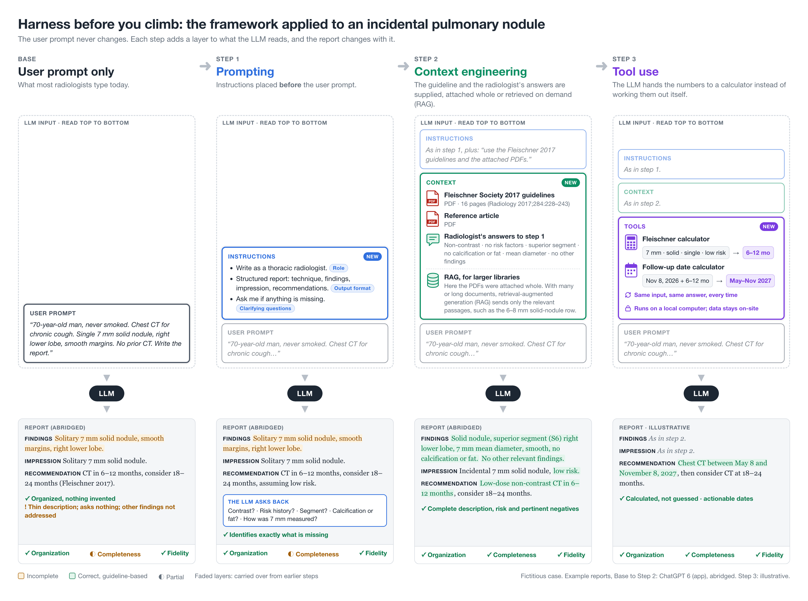

# CAR 2027 Educational Exhibit — Abstract Draft

**Title:** Harness Before You Climb: A Stepwise Framework for LLM-Assisted Radiology Reporting

## LEARNING OBJECTIVES

1. Differentiate strategies for customizing LLM-based applications in radiology reporting: prompting, context engineering, and tool use, and state what each adds.
2. Apply a stepwise framework that combines these strategies to common reporting scenarios.
3. Compare reports generated by LLM-based applications with and without this framework to identify differences in organization, completeness, and fidelity to supplied findings.

## BACKGROUND

Large language model (LLM) applications are increasingly used in radiology reporting to structure findings, draft impressions, and simplify reports. If used generically, they can omit findings, fabricate content, and produce inconsistent report formats. Output quality depends largely on how the model is guided, yet existing guidance is abundant, jargon-heavy, and often overwhelming for practicing radiologists. This exhibit presents a stepwise framework for customizing LLM-based applications in everyday reporting. The framework combines three strategies: prompting, which specifies the model's role, task, and output format; context engineering, which supplies templates, guideline criteria (e.g., Fleischner, O-RADS), reporting preferences, and reference documents retrieved on demand (retrieval-augmented generation, RAG); and tool use, which lets the model call external functions, such as calculators, through local Model Context Protocol (MCP) servers that keep data on-premises. The framework is applied to common reporting scenarios (e.g., incidental pulmonary nodules, adnexal lesions, incidental adrenal lesions). Side-by-side reports generated from identical findings, with and without the framework, illustrate differences in organization (required sections, in order), completeness (no omitted findings or descriptors), and fidelity to supplied findings (no fabricated or altered content). Repeated runs on two LLMs, scored by a blinded LLM judge and radiologists, quantify these differences.

## CONCLUSION

This stepwise framework translates technical LLM guidance into a practical approach that radiologists can adapt to everyday reporting. By combining these strategies, radiologists can use LLM-based applications to produce more organized, complete draft reports that remain faithful to supplied findings, while maintaining essential clinical oversight. As AI capabilities evolve, the ability to guide, contextualize, and critically review LLM outputs will be an increasingly valuable skill for radiologists incorporating these applications into clinical practice.

## FIGURE

**Figure.** Stepwise framework applied to an incidental 7 mm solid pulmonary nodule (fictitious case). The user prompt stays the same in every column; each step adds a layer to the LLM input: instructions placed before the user prompt (prompting), the Fleischner 2017 guideline PDF and the radiologist's answers to the model's questions, with retrieval-augmented generation (RAG) as the option for larger document libraries (context engineering), and local calculators for the follow-up interval and dates (tool use). Abridged reports are compared for organization, completeness, and fidelity to supplied findings; the Step 3 report is illustrative.

*Source: [figure/pipeline.html](figure/pipeline.html). Re-render with `figure/render.sh pipeline`. Upload the PNG separately in the portal; it is required and is shown to reviewers but not published.*

